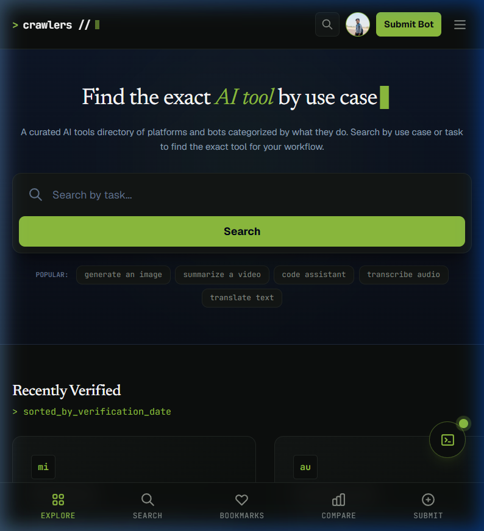

# crawlers

```console
$ crawlers --info
[system] status: active
[target] https://crawlers.dpdns.org
[index]  989 tools // 170 categories // 8 top-level sections
[stack]  supabase + cloudflare pages + cloudflare edge functions
[author] Cryo (@SubhamPro11)
```

Crawlers is a directory of AI tools, platforms, and bots categorized strictly by use case and functional role rather than brand hype. Designed for developers, researchers, and technical workflows needing precise tool discovery, Crawlers indexes ~989 tools across 170 categories and 8 core sections, delivering a terminal-inspired, dark-mode index built for scannability and performance.



---

## Features

- **Categorized Indexing**: ~989 AI tools organized across 170 categories in 8 top-level sections.
- **Automated Link Verification**: Custom link-checking Edge Function monitors URL health and flags stale entries.
- **Data-Driven Trending Badges**: Popularity and trending indicators calculated directly from real view-log telemetry rather than static metrics.
- **API & Route Hardening**: Mandatory sign-in gating on API endpoints with standardized 401 JSON error responses and client-side inactivity timeouts.
- **Tag Cross-Linking**: Structural tag taxonomy linking related tool use cases across category boundaries.
- **Security Engineering**: Strict Content Security Policy (CSP), custom `_headers` rules, Supabase Row Level Security (RLS) policies, and environment isolation.
- **SEO & Generative Engine Optimization (GEO)**: Automated JSON-LD structured data, canonical tagging, and standard `/llms.txt` formatting for AI agents.

---

## Tech Stack

| Component | Technology |
| :--- | :--- |
| **Frontend Framework** | Next.js 16 (App Router), React 19, TypeScript |
| **Styling** | Tailwind CSS v4, Lucide Icons |
| **Database & Auth** | Supabase (PostgreSQL, Row Level Security, Auth) |
| **Hosting & Edge** | Cloudflare Pages, `@opennextjs/cloudflare`, Cloudflare Edge Functions |

---

## Project Structure

```text
crawlers/
├── public/               # Static assets, preview images, and llms.txt
│   ├── crawlers-preview.png
│   └── llms.txt
├── scripts/              # Data ingestion, url verification, and SQL utilities
│   ├── crawlAiExtensions.js
│   ├── crawlAixploria.js
│   ├── crawlBestAiAgents.js
│   └── verifyAndCleanExtensions.js
├── src/
│   ├── app/              # Next.js App Router (pages, API v1 routes, tags, search)
│   ├── components/       # Terminal UI components, cards, and overlay windows
│   └── lib/              # Supabase client integration and helper utilities
├── supabase/             # Database migrations, RLS policies, and RPC functions
├── open-next.config.ts   # OpenNext Cloudflare adapter configuration
└── wrangler.jsonc        # Cloudflare Pages deployment manifest
```

---

## Local Setup

### Prerequisites

- Node.js (v20+)
- npm or pnpm
- A Supabase project instance

### Environment Configuration

Create a `.env.local` file in the root directory:

```env
NEXT_PUBLIC_SUPABASE_URL=your_supabase_project_url
NEXT_PUBLIC_SUPABASE_ANON_KEY=your_supabase_anon_key
```

### Installation & Execution

```bash
# Clone repository
$ git clone https://github.com/SubhamPro11/crawlers.git
$ cd crawlers

# Install dependencies
$ npm install

# Start local development server
$ npm run dev
```

The application will run locally at `http://localhost:3000`.

---

## Deployment Notes

Crawlers is configured for deployment on **Cloudflare Pages** using the OpenNext Cloudflare adapter (`@opennextjs/cloudflare`).

```bash
# Build production bundle for Cloudflare Pages
$ npm run build

# Deploy assets using Wrangler CLI
$ npx wrangler pages deploy .open-next/assets
```

Background link verification and health checks are executed via Cloudflare Edge Functions interfacing with Supabase RPC endpoints.

---

## Contributing

Crawlers is currently built and maintained as a solo project by Cryo (`SubhamPro11`). External pull requests and feature contributions are not currently being accepted. Issues or bug reports can be logged via GitHub.

---

## License

This project is licensed under the **Mozilla Public License Version 2.0 (MPL-2.0)**. See the [LICENSE](LICENSE) file for details.

---

## Links

- **Live Directory**: [https://crawlers.dpdns.org](https://crawlers.dpdns.org)
- **Author GitHub**: [@SubhamPro11](https://github.com/SubhamPro11)


