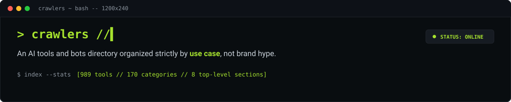
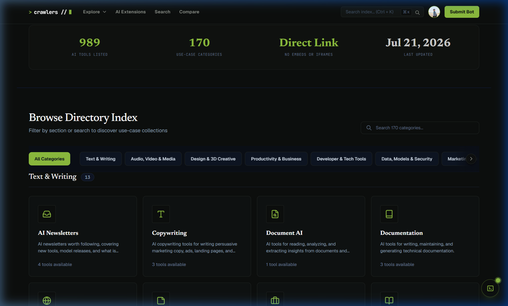
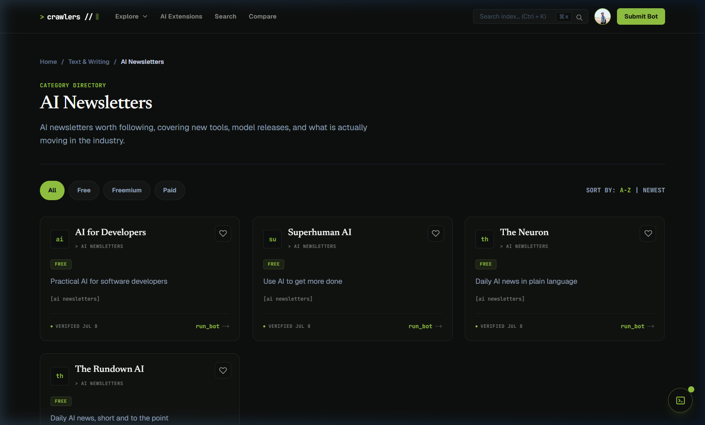
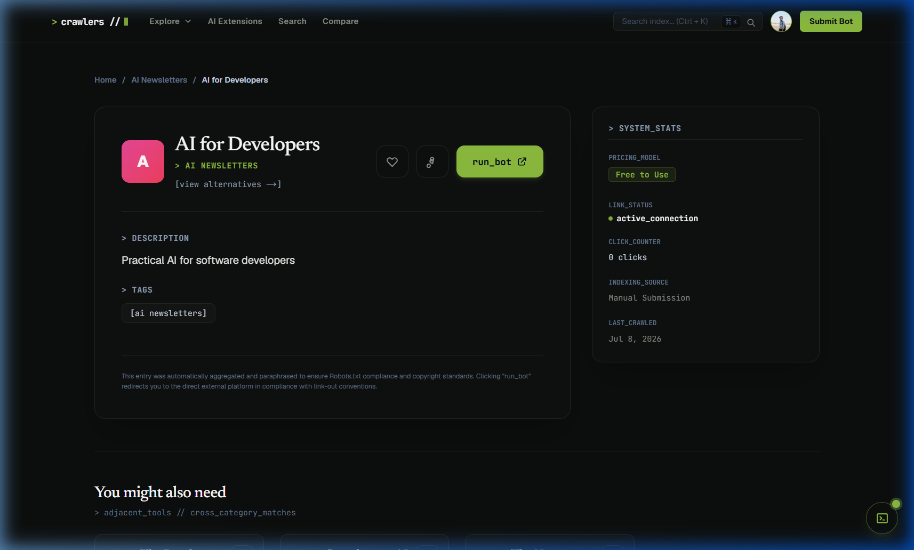

<p align="center">
  
</p>

<p align="center">
  
  
  
  
  
</p>

Crawlers is a directory of AI tools, platforms, and bots categorized strictly by use case and functional role rather than brand hype. Built for developers, researchers, and technical workflows that need precise tool discovery, it indexes ~989 tools across 170 categories and 8 core sections, delivered as a terminal-inspired, dark-mode index built for scannability and speed.

**Live:** [crawlers.dpdns.org](https://crawlers.dpdns.org)

<br>

## Contents

- [Features](#features)
- [How Categorization Works](#how-categorization-works)
- [Screenshots](#screenshots)
- [Tech Stack](#tech-stack)
- [Project Structure](#project-structure)
- [Local Setup](#local-setup)
- [Deployment](#deployment-notes)
- [Roadmap](#roadmap)
- [Contributing](#contributing)
- [License](#license)

<br>

## Features

| | |
|---|---|
| **Categorized Indexing** | ~989 AI tools organized across 170 categories in 8 top-level sections. |
| **Automated Link Verification** | Custom link-checking Edge Function monitors URL health and flags stale entries. |
| **Data-Driven Trending Badges** | Popularity and trending indicators calculated from real view-log telemetry, not static metrics. |
| **API & Route Hardening** | Mandatory sign-in gating on API endpoints, standardized 401 JSON error responses, client-side inactivity timeouts. |
| **Tag Cross-Linking** | Structural tag taxonomy linking related tool use cases across category boundaries. |
| **Security Engineering** | Strict CSP, custom `_headers` rules, Supabase RLS policies, environment isolation. |
| **SEO & GEO** | Automated JSON-LD structured data, canonical tagging, and `/llms.txt` for AI agents. |

<br>

## How Categorization Works

Tools aren't sorted by brand or popularity — they're indexed by what they actually do.

```text
crawl → scrape (robots.txt-compliant, rate-limited) → dedupe
     → classify into section / category / tags
     → rewrite listing copy in-house (no verbatim scraped text)
     → link-check pass (staleness badge if unreachable)
     → publish
```

8 top-level sections break down into 170 categories, so a listing for something like a "background removal API" sits under a specific functional category rather than a catch-all "Image Tools" bucket. Tags cross-link related categories so adjacent use cases (e.g. background removal ↔ image upscaling) stay discoverable from either side.

<br>

## Screenshots

| Homepage | Category View | Tool Detail |
|---|---|---|
|  |  |  |

<br>

## Tech Stack

| Layer | Technology |
|---|---|
| Frontend | Next.js 16 (App Router), React 19, TypeScript |
| Styling | Tailwind CSS v4, Lucide Icons |
| Database & Auth | Supabase (PostgreSQL, Row Level Security, Auth) |
| Hosting & Edge | Cloudflare Pages, `@opennextjs/cloudflare`, Cloudflare Edge Functions |

<br>

## Project Structure

```text
crawlers/
├── public/               # Static assets, preview images, and llms.txt
│   ├── crawlers-banner.svg
│   ├── screenshot-home.png
│   ├── screenshot-category.png
│   ├── screenshot-detail.png
│   └── llms.txt
├── scripts/              # Data ingestion, url verification, and SQL utilities
│   ├── crawlAiExtensions.js
│   ├── crawlAixploria.js
│   ├── crawlBestAiAgents.js
│   └── verifyAndCleanExtensions.js
├── src/
│   ├── app/               # Next.js App Router (pages, API v1 routes, tags, search)
│   ├── components/        # Terminal UI components, cards, and overlay windows
│   └── lib/                # Supabase client integration and helper utilities
├── supabase/              # Database migrations, RLS policies, and RPC functions
├── open-next.config.ts   # OpenNext Cloudflare adapter configuration
└── wrangler.jsonc         # Cloudflare Pages deployment manifest
```

<br>

## Local Setup

**Prerequisites:** Node.js 20+, npm or pnpm, a Supabase project instance.

Create `.env.local` in the root directory:

```env
NEXT_PUBLIC_SUPABASE_URL=your_supabase_project_url
NEXT_PUBLIC_SUPABASE_ANON_KEY=your_supabase_anon_key
```

```bash
$ git clone https://github.com/SubhamPro11/crawlers.git
$ cd crawlers
$ npm install
$ npm run dev
```

App runs locally at `http://localhost:3000`.

<br>

## Deployment Notes

Deployed to **Cloudflare Pages** via the OpenNext Cloudflare adapter (`@opennextjs/cloudflare`).

```bash
$ npm run build
$ npx wrangler pages deploy .open-next/assets
```

Background link verification and health checks run via Cloudflare Edge Functions calling Supabase RPC endpoints.

<br>

## Roadmap

- [ ] Full-text search improvements
- [ ] Public API rate-limit tiers
- [ ] Expanded staleness detection coverage
- [ ] User-submitted tool queue

<br>

## Contributing

Crawlers is built and maintained solo by Cryo (`SubhamPro11`). External PRs aren't currently accepted — bug reports and issues can be logged via GitHub.

<br>

## License

Licensed under the **Mozilla Public License 2.0 (MPL-2.0)**. See [LICENSE](LICENSE) for details.

<br>

<p align="center"><sub>
  <a href="https://crawlers.dpdns.org">crawlers.dpdns.org</a> · built by <a href="https://github.com/SubhamPro11">@SubhamPro11</a>
</sub></p>
